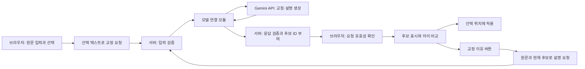

# 구조 설계 — 독립 웹 데모

> 역할: 화면·서버·LLM의 경계, API·데이터·코드 구조를 정의한다. 상태: 2026-11-06 기본 화면·서버·자동 검증 및 Gemini 어댑터 구현. Gemini 3.5 Flash-Lite로 실제 후보 생성·적용을 확인했고 설명 API도 구현·예문 검증했다. 실행·검증 결과와 명령은 README에서 확인한다.

## 1. 기술 구성

| 영역 | 채택한 구성 | 이 프로젝트에서의 이유 |
|---|---|---|
| 화면 | React + TypeScript + Vite | 원문·선택·요청·결과 상태를 구분하고 화면을 구성 |
| 스타일 | 일반 CSS + CSS 변수 | 두 영역의 화면과 몇 가지 상태에 필요한 규칙을 직접 관리 |
| 서버 | Node.js + TypeScript + Express | 교정·설명 HTTP 요청 처리와 API 키 보관 |
| 요청 검증 | Zod | 요청과 모델 응답이 정해진 형식인지 실행 시 검사 |
| 통신 | JSON 기반 HTTP API + fetch | 작은 규모의 요청·응답을 명시적으로 관리 |
| 상태 관리 | React reducer + 요청별 식별자 | 편집·선택 변경 시 관련 상태를 함께 무효화 |
| 패키지 관리 | npm | 한 프로젝트 안에서 화면·서버 의존성 관리 |
| 저장 | 브라우저 메모리, DB 없음 | 첫 범위에 문서 저장·로그인·히스토리가 없음 |
| 모델 제공자·모델 | Gemini, 모델명은 서버 설정 | 무료 구간부터 시험; 현재 예시는 gemini-3.5-flash-lite, 실제 교정·설명 예문 확인 |

현재 범위에 맞춰 이 구성으로 독립 구현했다.

React의 상태 관리, Vite의 개발·빌드, Express의 HTTP 라우팅, Zod의 스키마 검증을 사용한다. 근거 문서: [React 상태 관리](https://react.dev/learn/managing-state), [Vite 안내](https://vite.dev/guide/), [Express 라우팅](https://expressjs.com/en/guide/routing/), [Zod 기본 사용](https://zod.dev/basics). 기술 구성 선택은 이 기능들에 근거한 프로젝트 설계 판단이다.

Node 20.12.2·npm 10.5.0에서 설치·타입 검사·빌드를 확인했다. React 19.3.1, Express 5.3.0, Zod 4.6.7, Vite 6.4.5, TypeScript 5.9.3을 설치했으며 잠금 파일로 관리한다. Vite는 기존 로컬 Node와 호환되는 6 계열을 선택했다. [Vite 6 환경 안내](https://v6.vite.dev/guide/)

## 2. 데이터 흐름과 책임



- 브라우저: 문서 전체·선택 위치·문서 버전 관리, 차이 표시, 적용 직전 검사, 후보 적용.
- 서버: 선택 텍스트·후보 형식과 길이 검증, 프롬프트 구성, 모델 요청, 응답 형식 검증, 안전한 오류 반환.
- 모델 연결 모듈: 특정 제공자의 요청·응답 방식을 앱 내부 형식으로 변환. 제공자를 바꿔도 화면·선택 처리를 바꾸지 않도록 경계를 둔다.
- 외부 LLM: 교정 후보 또는 설명 생성. 위치 추적과 적용 위치 결정은 맡기지 않는다.
- 설명은 최초 버튼 클릭 시 별도 호출한다. 같은 결과에서 다시 열면 브라우저에 남아 있는 설명을 재사용한다. 현재는 후보 생성과 설명에 같은 설정 모델을 사용한다.

## 3. 브라우저에서 보관할 데이터

| 데이터 | 주요 필드 | 용도 |
|---|---|---|
| 문서 | `text`, `revision` | 원문과 편집 시점 구분 |
| 선택 | `start`, `end`, `text`, `revision` | 원문 내 정확한 위치와 선택 변경 구분 |
| 교정 요청 스냅샷 | `requestId`, `documentRevision`, `selectionRevision`, `start`, `end`, `sourceText` | 결과가 어느 선택에서 나온 것인지 확인 |
| 교정 결과 | `requestId`, `sourceText`, `candidates` | 원문과 후보를 한 묶음으로 유지 |
| 후보 | `id`, `text` | 결과 내에서 설명·적용 대상을 식별 |
| 설명 상태 | `attempt`, `loading`, `explanations`, `error`, `open` (교정 요청 ID로 컴포넌트 분리) | 현재 결과에 대한 설명만 표시 |

- 문서와 선택의 revision은 값이 실제 바뀔 때만 증가한다. 같은 선택에 대한 이벤트가 여러 번 발생해도 기존 결과를 매번 제거하지 않는다.
- textarea의 선택 위치는 `selectionStart`·`selectionEnd`와 JavaScript 문자열 인덱스를 사용한다. 선택 글자 수의 코드 포인트 계산과 혼용하지 않는다. [선택 위치 API](https://developer.mozilla.org/en-US/docs/Web/API/HTMLTextAreaElement/selectionStart)
- 원문 전체는 최대 20,000 코드 포인트, 선택 텍스트는 최대 1,000 코드 포인트다. 길이 초과 입력은 조용히 자르지 않고 안내한다.
- 선택 위치는 브라우저 내부 정보이며 모델에 보내지 않는다. 설명 요청도 현재 선택 원문과 해당 후보만 전송한다.

### 늦은 응답과 잘못된 적용 방지

1. 교정 실행 시 선택 정보를 복사해 고유한 요청 식별자와 함께 보관한다.
2. 응답 수신 시 응답의 요청 ID와 현재 활성 요청 ID, 문서·선택 revision이 모두 일치해야 결과를 수용한다.
3. 원문 편집·새 선택·선택 해제 시 활성 요청을 무효화하고 가능한 경우 전송을 취소한다. 네트워크 취소 성공 여부와 무관하게 이전 응답을 버린다.
4. 무효화한 요청의 늦은 성공·실패 응답은 새 결과와 로딩 상태를 덮어쓰지 못한다. 새 선택에서는 새로운 요청을 시작할 수 있다.
5. 후보 적용 직전에도 버전과 `document.text.slice(start, end) === sourceText`를 확인한다.
6. 적용은 앞부분 + 후보 텍스트 + 뒷부분으로 수행한다. 원문 전체에서 문장 내용을 검색해 교체하지 않는다.
7. 적용 후 문서·선택 버전을 갱신하고 새 범위를 선택한다. 기존 교정 결과·설명·진행 중 요청은 무효화한다.

설명 응답은 설명 요청 ID와 연결된 교정 요청 ID가 모두 현재 상태와 맞아야 표시한다. 설명 창을 닫는 동작은 선택을 바꾸지 않으며, 늦게 도착한 설명이 창을 자동으로 다시 열지 않는다.

## 4. HTTP API 계약

API는 모델 제공자와 독립적인 앱 내부 계약이다. health·corrections·explanations를 `server/app.ts`에 구현했다.

### GET /api/health

서버 상태와 모델 설정 존재 여부만 반환한다. `modelConfigured`는 설정 존재 여부이며 실제 연결 성공을 의미하지 않는다. 키나 내부 URL을 노출하지 않는다.

### POST /api/corrections

요청 예시:

```json
{
  "requestId": "correction-001",
  "sourceText": "금요일까지 자료를 보내주시면 좋을 것 같습니다."
}
```

응답 형태 예시이며 아래 문장은 실제 생성 결과가 아니다:

```json
{
  "requestId": "correction-001",
  "sourceText": "금요일까지 자료를 보내주시면 좋을 것 같습니다.",
  "candidates": [
    { "id": "candidate-001", "text": "금요일까지 자료를 보내주시면 감사하겠습니다." }
  ]
}
```

- 입력: 공백만 있는 값 거절, 최대 1,000 코드 포인트. 앞뒤 공백은 임의로 trim하지 않는다.
- 서버가 원래 입력을 그대로 `sourceText`에 넣고 후보 ID를 부여한다. 모델이 돌려준 원문·요청 ID를 신뢰해서 덮어쓰지 않는다.
- 모델에 최대 3개의 후보를 요청한다. 응답 형식 검증 후 비어 있지 않은 1~3개를 반환한다. 3개 초과·잘못된 항목·전부 빈 값은 오류로 처리한다.
- 후보별 길이는 최대 2,000 코드 포인트로 제한한다. 원문 길이가 늘어날 수 있으나 과도한 출력은 차단한다.
- 원문과 동일하거나 후보끼리 같은 경우는 생성 오류로 보지 않는다. 중복 없는 생성을 보장하지 않는다.

### POST /api/explanations

```json
{
  "requestId": "explanation-001",
  "sourceText": "금요일까지 자료를 보내주시면 좋을 것 같습니다.",
  "candidates": [
    { "id": "candidate-001", "text": "금요일까지 자료를 보내주시면 감사하겠습니다." }
  ]
}
```

응답은 요청의 `requestId`, `sourceText`, `candidates`와 `explanations: [{ candidateId, explanation }]`를 반환한다. 브라우저는 원문·후보 텍스트·ID 일치를 검사한다. 교정 요청 ID는 컴포넌트 key로 유지하여 결과 변경·적용 시 설명 요청을 취소하고 오래된 응답을 버린다.

- 서버에 문서를 저장하지 않으므로 브라우저가 현재 결과의 원문과 후보를 다시 보낸다. 요청 ID는 연결용이며 인증·권한 증명으로 사용하지 않는다.
- 후보 수·길이·ID 중복을 검사한다. 모델 결과의 후보 ID 집합이 입력과 정확히 맞아야 한다. 누락·중복·알 수 없는 ID가 있으면 형식 오류로 처리한다.
- 설명은 후보별 1~2문장을 지시하며, 최대 400 코드 포인트로 제한한다. 초과 결과를 임의로 잘라 의미를 바꾸지 않고 오류로 처리한다.
- 원문 동일 후보는 문자열을 비교하여 ‘원문과 동일하여 변경된 표현이나 의미가 없습니다.’로 표시한다. 그 외 설명은 원문과 후보의 실제 차이에 근거하도록 요청한다.
- 형식 검증 통과는 설명 내용이 정확하다는 증명이 아니다. 날짜·수치·조건 변화에 대한 내용 검증은 별도 사례 평가로 확인한다.
- `server/llm/explanation-check.ts`의 인용 문자열 검사를 설명 API의 형식·ID 검사 뒤에 적용한다. 원문 또는 해당 후보에서 정확히 발견되는 닫힌 한 줄 인용만 허용한다. 공백·줄바꿈을 정규화하지 않는다. 제공자 어댑터를 직접 호출하는 평가 도구는 이 HTTP 계층 검사를 자동으로 거치지 않으므로 생성 품질 비교와 API 차단 검증을 구분한다. 의미 정확성, 인용 방향, 모든 인용 문법을 검증하는 기능은 아니다.

### 공통 실패 응답

`{ requestId, error: { code, message, retryable } }` 형태로 반환한다. 파싱 불가능한 요청은 `requestId`가 null일 수 있다.

| HTTP / code | 의미 | 화면 동작 |
|---|---|---|
| 400 / INVALID_INPUT | 길이·형식 오류 | 입력 수정 안내 |
| 503 / MODEL_NOT_CONFIGURED | API 설정 없음 | 연결 설정 필요 안내, 가짜 결과 표시 금지 |
| 503 / MODEL_CONFIGURATION_ERROR | 제공자의 인증·권한·모델·요청 설정 오류 | 키·모델명·접근 권한 확인, 결제 전환 유도 안 함 |
| 429 / MODEL_QUOTA_EXCEEDED | 제공자의 사용량·요청 횟수 제한 | 한도 확인 및 기다린 뒤 수동 재시도 |
| 422 / MODEL_BLOCKED | 제공자가 결과를 차단함 | 입력 확인 안내 |
| 502 / MODEL_RESPONSE_INVALID | 모델 응답 형식 오류 | 원문 유지·수동 재시도 |
| 502 / EXPLANATION_QUOTE_MISMATCH | 설명의 인용이 원문·대응 후보에 없음 | 설명 묶음 미표시, 후보 적용 유지·설명 수동 재시도 |
| 502 / MODEL_REQUEST_FAILED | 모델 요청 실패 | 내부 오류 원문 대신 일반 안내 |
| 503 / MODEL_UNAVAILABLE | 공급자가 일시적인 요청 실패 응답 반환 | 원문 유지·잠시 기다린 뒤 수동 재시도 |
| 504 / MODEL_TIMEOUT | 제한 시간 초과 | 원문 유지·수동 재시도 |

서버 요청당 모델 호출 제한 시간은 45초이며 자동 재시도를 하지 않는다. 브라우저에도 50초 제한을 두었다. 사용자 재시도마다 새 ID를 사용한다. 취소 후 모델 측 처리가 이미 진행되었다면 사용량까지 취소되었다고 보장하지 않는다. 테스트 제공자로 시간 제한을 확인했으며 Gemini 어댑터는 AbortSignal을 fetch에 전달한다. 실제 제공자의 응답 시간은 실행마다 달라질 수 있으므로 검증 기록에 별도로 남긴다.

## 5. 모델 연결 경계

- 내부 인터페이스는 `generateCandidates(sourceText, signal)`를 구현했다. `generateExplanations(sourceText, candidates, signal)`도 구현했다. 설명 메서드가 없는 제공자는 설명 요청 시 미설정 안내를 반환한다.
- 제공자별 요청 형식·모델명·응답 추출은 `server/llm/` 안에서 처리한다. 화면은 제공자 SDK를 직접 호출하지 않는다.
- API가 준비되기 전에는 `MODEL_NOT_CONFIGURED`를 반환한다. 테스트용 고정 응답은 테스트에서 명시적으로 주입하며 실제 데모의 교정 성공으로 사용하지 않는다.
- `config.ts`는 `LLM_PROVIDER=gemini`를 읽어 `gemini.ts` 어댑터를 생성한다. 키·모델이 없으면 미설정 제공자를 사용하고, 알 수 없는 제공자·잘못된 모델 경로는 설정 오류로 중단한다. 다른 제공자를 추가할 때 인터페이스를 구현하고 이 생성 함수에 연결한다.
- 개발·빌드 실행 모두 프로젝트 루트의 `.env`를 Node의 `loadEnvFile`로 읽는다. 기존 프로세스 환경변수가 우선한다. 키는 서버에서만 사용하며 `VITE_` 접두사나 화면 번들에 넣지 않는다. `.env.example`에는 변수명과 모델 예시만 두고 `.env`는 Git에서 제외한다.
- Gemini는 `POST https://generativelanguage.googleapis.com/v1beta/models/{model}:generateContent`를 사용한다. 키는 `x-goog-api-key` 헤더로 보내고 리다이렉트는 거절한다. 교정 지침은 `systemInstruction`, 선택 텍스트는 사용자 메시지의 JSON 데이터로 분리한다. 모델 입력에는 요청 ID·선택 위치·전체 문서를 넣지 않는다.
- `generationConfig`에서 JSON Schema로 `{ candidates: string[] }` 형식을 요청한다. Gemini 응답 1개 안에 교정 후보 1~3개를 담으며 출력 최대 8,192토큰, API 호출은 실행 1회당 1번이다. 검색·도구 호출·자동 재시도·모델 자동 교체는 하지 않는다.
- Gemini 3 계열의 짧은 교정 요청에는 `thinkingConfig.thinkingLevel: LOW`를 지정해 추론 부담을 줄인다. 해당 필드를 지원하지 않는 이전 계열에는 보내지 않는다. 시간 초과를 무작정 늘리거나 한 번의 실패 후 자동 재요청하지 않는다. LOW가 공급자의 지연·503을 해결한다는 보장은 없다.
- 공급자 응답은 완료 사유가 `STOP`인 경우만 수용한다. 차단·잘린 출력·잘못된 JSON·후보 수·길이 오류는 정상 후보로 표시하지 않는다. thought 표시는 결과에서 제외한다. 원문·API 키·공급자 오류 본문은 로그나 화면에 노출하지 않는다. 형식 검증으로 의미 보존까지 보장하지 않는다.
- 현재 모델 예시 `gemini-3.5-flash-lite`는 2026-11-06 공식 가격표의 무료 구간을 참고했다. 실제 프로젝트에서 해당 모델의 무료 사용 가능 여부를 확인해야 한다. 코드로 요금제를 판별하거나 무료 사용을 강제할 수 없다. 유료 결제 설정은 이번 범위에 포함하지 않는다.
- 모델 입력에서 교정 지시와 사용자 문장을 구분한다. 문장 안의 지시문을 앱 명령으로 취급하지 않도록 프롬프트와 응답 검증을 설계한다.
- 생성과 설명에 같은 모델을 쓸 수 있지만 동일 모델 사용을 전제로 화면을 설계하지 않는다.

연결 근거: [Gemini generateContent API](https://ai.google.dev/api/generate-content), [공식 메서드 명세](https://aistudio.google.com/api-reference/generate-content/generate-content), [가격표](https://ai.google.dev/gemini-api/docs/pricing). 연결 코드는 테스트 응답으로 검증했으며 실제 계정 호출 검증과 구분한다.

## 6. 변경 강조 처리

- 브라우저에서 원문과 후보를 코드 포인트 배열로 비교한다. 문자 단위 LCS 기반 비교로 추가·삭제·유지 구간을 만든다.
- 최대 원문 1,000자·후보 2,000자 범위에서 동작 시간을 측정한다. 전체 편집 문서 20,000자를 이 비교에 넣지 않는다.
- 연속된 동일 작업 구간을 합쳐 표시한다. 공백·줄바꿈 표시용 기호와 실제 적용 문자열은 분리한다.
- 비교 결과는 표시용 데이터다. 후보 텍스트 자체를 다시 조립해 적용하지 않고 서버가 반환한 원본 후보 문자열을 사용한다.
- 반응이 느리거나 한글 표현 구분이 읽기 어려우면 비교 알고리즘·단위를 조정하되, 원문·후보 연결과 적용 규칙은 유지한다.

## 7. 실제 코드 구조

아래 구조는 현재 구현을 설명한다. 팀 협업 중 책임 분리나 기능 확장에 따라 폴더·파일·코드·설정·도구 구성을 바꿀 수 있으며, 변경된 구조와 실행·검증 방법을 관련 문서에 함께 반영한다.

```text
writing-demo/
├── docs/                     # 기획·기능·화면·구조 문서
├── client/src/
│   ├── App.tsx               # 원문 입력·선택·요청·전체 화면
│   ├── components/           # 후보·설명·아이콘
│   ├── state/                # 편집·선택·요청 상태와 reducer
│   ├── lib/                  # API 호출, 차이 계산, 선택 위치 처리
│   └── styles/               # 레이아웃·색·상태 표현
├── server/
│   ├── app.ts                # health·corrections·explanations·검증·오류 처리
│   ├── dev.ts                # Vite와 API를 함께 실행
│   ├── index.ts              # 빌드한 정적 화면과 API 실행
│   └── llm/                  # provider 인터페이스·config·prompt·gemini 어댑터
├── shared/                   # 입출력 스키마·공통 제한값
├── scripts/                  # 화면·서버 빌드·실제 설명 평가
└── tests/                    # 선택 적용·늦은 응답·API 오류·브라우저 확인
```

하나의 패키지와 잠금 파일을 사용한다. `server/dev.ts`에서 Vite를 Express 미들웨어로 연결해 API와 화면을 5173번 포트 하나로 제공한다. 빌드 후에는 `server/index.ts`가 정적 화면과 API를 제공한다. 명령어는 README에 기록한다.

현재 API 두 개 규모에서는 라우트·서비스 폴더를 먼저 나누지 않고 `app.ts`에 배치했다. 테스트 제공자는 테스트에서만 주입한다. 실제 실행은 환경변수에 따라 Gemini 또는 미설정 제공자를 사용하며, 시작·health 조회만으로 외부 모델을 호출하지 않는다.

## 8. 실행·검증과 남은 선택

- 초기 실행 범위는 로컬 브라우저 데모다. 외부 공개 배포는 현재 결정하지 않았다.
- 서버는 요청 본문과 모델 출력 원문을 로그로 남기지 않는다. 요청별 오류 코드·소요 시간 로깅은 아직 구현하지 않았다. 별도 평가 스크립트가 저장하는 실행 결과는 일반 서버 로그와 구분한다. 브라우저 저장소나 DB에 문장을 영구 보관하지 않는다.
- 새로운 환경에서는 공개 가능한 짧은 문장으로 실제 교정·설명 요청을 확인한다. 개인 환경에서의 성공과 팀원 환경에서의 성공은 구분한다.
- 자동 검증은 선택 위치 보존·오래된 응답 폐기·후보 적용·형식 오류처럼 중요한 분기를 중심으로 한다. 브라우저에서는 입력·선택·실행·비교·적용·설명 흐름을 확인한다.
- 교정·설명 API와 UI를 구현했다. 남은 확인은 팀원별 무료 프로젝트·키·모델 접근, 실제 응답 시간·교정 및 설명 품질·타임아웃 적정성, 사용자 효과와 공개 배포 여부다.

참고: [기획](PRD.md), [기능명세](FEATURE_SPEC.md), [화면 설계](DESIGN.md)
